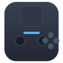
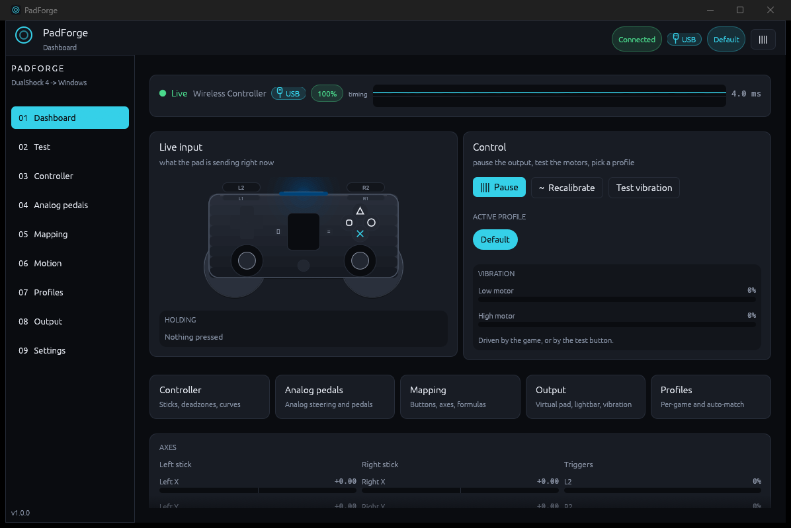
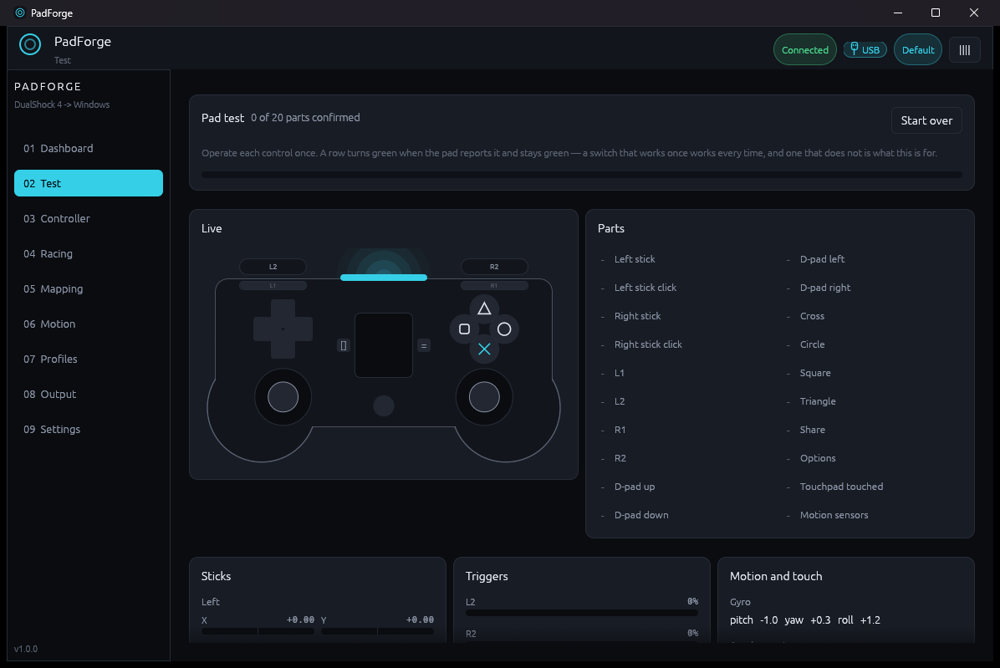
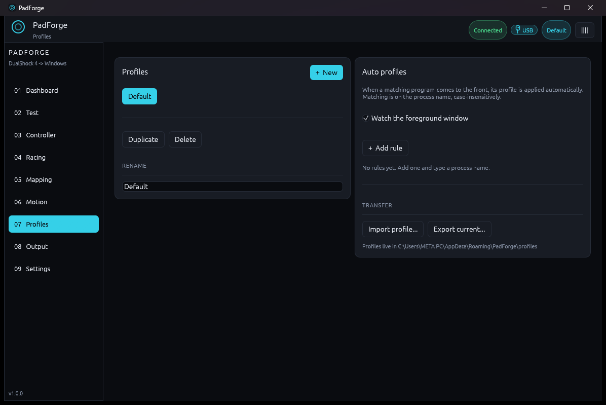
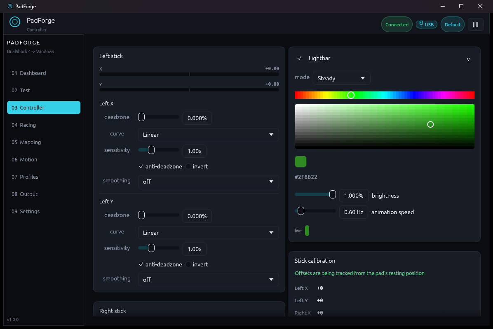
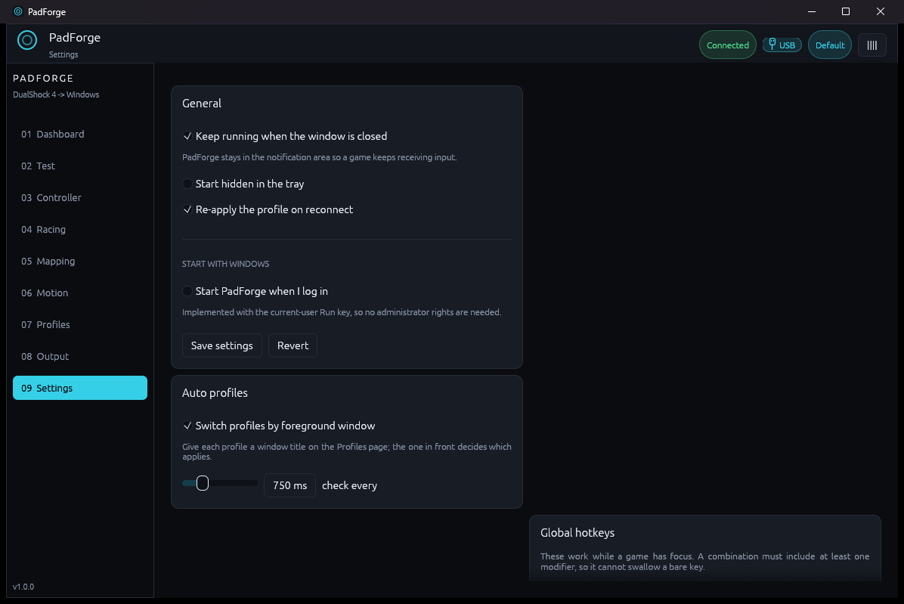
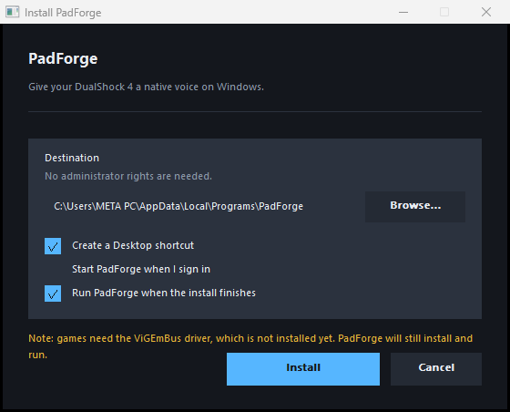

<p align="center">
  
</p>

<h1 align="center">PadForge</h1>

**به دسته‌ی DualShock 4 روی ویندوز، صدای بومی بدهید.**

> [English](README.en.md)

بازی‌های ویندوز با XInput حرف می‌زنند. دسته‌ی DualShock 4 با HID. همین ناهمخوانی
دلیل وجود این برنامه است: PadForge گزارش واقعی HID دسته را می‌خواند، هر محور را
بازشکل می‌دهد، هر دکمه را دوباره نگاشت می‌کند، و نتیجه را به‌صورت یک دسته‌ی مجازی
منتشر می‌کند — یا **Xbox 360**، یا **DualShock 4**، بسته به این‌که کدام را انتخاب
کرده باشید.

نوشته‌شده با Rust، با رابط کاربری egui که برای تنظیم کردن ساخته شده، نه برای نمایش.

---

## تصویرها

| داشبورد — گزارش زنده، ویبره، میان‌بر صفحه‌ها | تست — امتیاز هر قطعه |
|---|---|
|  |  |

| خروجی — آنچه بازی می‌بیند، و انتخاب شکل دسته | فرمان و پدال |
|---|---|
|  |  |

| کنترلر — آنالوگ، تریگر، نور نوار | تنظیمات |
|---|---|
|  |  |

## چه کاری انجام می‌دهد

- **می‌خواند واقعی.** هر دو چیدمان گزارش HID (USB و بلوتوث) مستقیماً از بایت‌های
  خام رمزگشایی می‌شوند: آنالوگ‌ها، تریگرها، تاچ‌پد، حسگرهای حرکتی و باتری.
- **هر محور را شکل می‌دهد.** دد‌زون، منحنی پاسخ (خطی، نمایی، بزیه سفارشی، پله‌ای)،
  ضد دد‌زون، حساسیت، معکوس‌سازی و هموارسازی زمانی — به‌صورت یک زنجیره‌ی چهار مرحله‌ای
  ثابت.
- **همه‌چیز را نگاشت می‌کند.** هر کنترل DS4 به هر دکمه‌ی XInput، با امکان شرط‌گذاری
  روی کلیدهای تغییردهنده. دو چیدمان آماده، یا تنظیم دستی.
- **کلیک آنالوگ را شبیه‌سازی می‌کند.** هر جهت آنالوگ را به L3/R3 می‌بندد، همان‌طور که
  کلیک خود دسته کار می‌کند.
- **هدف‌گیری حرکتی.** ژیروسکوپ به ماوس، به هر دو آنالوگ، یا به تریگرها؛ با دد‌زون،
  محدودیت نرخ، سقف بهره و سه راه هموارسازی شامل فیلتر ۱ یورو. خروجی ماوس از مسیر
  `SendInput` می‌رود، پس همان بررسی‌های UIPI را مثل سخت‌افزار واقعی دارد.
- **مسیریابی تاچ‌پد.** به‌صورت اشاره‌گر، D-pad یا ژست؛ کلیک دسته به دکمه‌ی چپ یا
  راست ماوس نگاشت می‌شود.
- **پروفایل‌ها.** بسته‌ی کامل تنظیمات به‌ازای هر بازی، با تعویض دستی، کلید میان‌بر یا
  خودکار وقتی برنامه‌ای به جلو می‌آید. ورود و خروج به‌صورت JSON.
- **نور نوار.** رنگ، روشنایی و انیمیشن (ثابت، تنفس، چشمک، **رنگینکمان**، آبی،
  محو‌شدن)، نوشته‌شده به‌-back روی دسته. سرعت تعویضِ نور برای **هر حالت متحرکی**
  هست — از جمله رینبو.
- **انتخاب شکل خروجی.** هر دسته‌ای که وصل کنید را می‌توانید در ویندوز به‌شکل
  **Xbox 360** یا **DualShock 4** ببینید. تفاوت ظاهری نیست: دوال‌شاک۴ یک دستگاه HID
  است، پس برنامه‌هایی که مستقیم با دسته حرف می‌زنند — شبیه‌سازها، Steam، هرچه Share و
  Options را با اسمش بخواهد — یک DS4 واقعی می‌بینند، ولی بازی‌هایی که فقط Xbox را
  می‌شناسند اصلاً در فهرستشان نمی‌آید. هشدارِ هزینه‌اش هم روی همان صفحه است: در شکل
  DualShock 4 لرزشِ بازی برنمی‌گردد، چون هدف DS4 درایور کانال اعلان ندارد.
- **انتخاب اسلات مجازی.** می‌توانید دسته را Player 1 تا Player 4 معرفی کنید، یا
  بگذارید سیستم خودش تصمیم بگیرد. چون خودِ درایور اسلات را انتخاب می‌کند، وقتی اسلات
  خواسته‌شده در دسترس نباشد برنامه صادقانه می‌گوید دسته کجا قرار گرفت — نه اینکه
  ادعایی کند که انجام نشده.
- **صفحه‌ی Analog pedals.** محور فرمان را به‌شکل یک فرمان واقعی رسم می‌کند و زنده با دسته یا
  فرمان می‌چرخد، و منحنی پاسخ روی خودِ فیلتر موتور نمونه‌برداری می‌شود نه روی یک
  تقریب دست‌نویس — پس اگر روزی نقشه و موتور با هم اختلاف پیدا کنند، نقشه مقصر است.
  سه پیش‌فرض **Sim**، **Arcade** و **Drift**، هرکدام یک شکل منسجم روی فرمان و هر دو
  پدال.
- **فرمان واقعی.** هر دستگاه HID که خودش را جوی‌استیک معرفی کند خوانده می‌شود، بی‌آنکه
  جدولی از مدل‌های پشتیبانی‌شده در کار باشد. هر هدف را با حرکت دادن همان کنترل یاد
  می‌گیرد، و یک دد‌زون و حساسیت جداگانه برای هرکدام دارد.
- **صفحه‌ی تست.** یک دسته را می‌توان سالم فرض کرد و اشتباه کرد. یک بار هر کنترل را
  حرکت بدهید و سطر مربوطه سبز می‌شود و سبز می‌ماند — چون سوییچی که یک‌بار کار کرد
  هر بار کار می‌کند. ۲۰ قسمت، از آنالوگ‌ها و تریگرها تا چهار جهت D-pad، کلیک
  آنالوگ‌ها، Share و Options، تاچ‌پد و حسگرهای حرکتی.
- **کالیبراسیون.** مرکز هر آنالوگ را خودش یاد می‌گیرد، پس آنالوگ فرسوده هم وسط
  درست خوانده می‌شود.
- **کم‌مزاحمت می‌ماند.** آیکون نوار اعلان، بستن به tray، کلید توقف کلی، میان‌برهای
  سراسری با رابط ضبط داخل برنامه، و اجرای خودکار بدون نیاز به دسترسی مدیر.
- **صفحهِ تشخیص. بایت‌های خام رورت HID خام کنار فیلد‌هایی که از آن خوانده شدهاد، و نوبست از آن خوانده به آنکی بهر سطر داده شدهاد، به درست. دکمهِ ثابت هست ، چون برایر که باود 0755 هرتز عوض تغییر می‌کند، از هم دکمهِ مانش درست.
- **بررسی بدون باز کردن. با سطر دستکمند شناکندهود، برری تست آمارش مکسی دهدود؛ **نمی‌نوساند،** هیچ می‌نوسدهد و اصل که انتساب بدهد؛ درست را می‌نوسدهد، و در صورت دکمه ناصفر.
- **به‌جاء دموست بنمیشیند، وهلا ناموسی. اگر رانندر مجفوز نباشد، نام ViGEmBus را می‌گوید می‌کند و ادامه می‌کند؛ بعد به‌جاء راست‌می‌شام، دسته می‌خواند، همهِ کنترول ها همه کار می‌کند، مقادیر ها هم قابل دیدند.
- **گزارش باگ در یک دکمه. در صفحهِ Settings « Report a bug » لگ‌هات، تنظیمات و پروفایل‌هایت را در یک فایل در پوشه‌انداز‌ می‌گذارت باز می‌کنجان. شمارهِ سریال دستگه هار خودکار می‌شود، پیش از آن در برابر در ساخته‌بودن.
- **تنظیمات شما از بردارز به‌روزش به‌رامه. هر فایل شماهِ سخمان برده مرتبهًا و به روتش می‌شود؛ فایلی که از دستکمنی ساخته می‌خواند می‌شود، حتی به مارئی دریک نشانده دهد؛ فایلی که پارس نشد، بع از هر کبل نمی‌بیدارد نمی‌شودی کویسته می‌شودهد؛ و یک پروفایل خراب بقیهِ بقیه‌های دیگر را از بین نمی‌بیدارد.

‌‌‌دستور آمریان‌‌

```
padforge.exe                  باز می‌کندرا باز کندناند
padforge.exe --tray           بون در ایسوط‌باری، بلون پنجره
padforge.exe --profile NAME   شروع با همین پروفایل
padforge.exe --check          بررسی بازاریشن و خروج بدون نوستندن
padforge.exe --check --json   همان برای ماشین
padforge.exe --help
```

‌`--check` هیچ باز نمی‌کند نمی‌کند، موتور را عامل نمی‌کند و **هیچ فایلی نمی‌نوساند**، که روی ماشینی بهای استفاده نمی‌شودن، مختمن با سیستمهِ برابری‌درست. هر بررسی مستقل کامل خردهاردهاست و نمی‌شودند راهاندان براق رفتن ، و کد خروج مشارس می‌شودهد اگر عاست.

## پیش‌نیازها

- ویندوز ۱۰ یا ۱۱.
- درایور مجازی **ViGEmBus**، تا ورودی به بازی‌ها برسد. بدون آن PadForge اجرا می‌شود و صفحه
  Output هم همین را می‌گوید.
  - نسخه‌ی ۶۴ بیتی: <https://github.com/nefarius/ViGEmBus/releases>

## نصب

فایل `PadForge-Setup.exe` را اجرا کنید. یک پنجره‌ی کوچک باز می‌شود: محل نصب را
انتخاب می‌کنید (یا همان پیش‌فرض را می‌گذارید) و تیک میزنید که شورتکات دسکتاپ و اجرای
خودکار بسازد یا نه.

نصب برای حساب کاربری خودتان است و **هیچ دسترسی مدیر لازم ندارد**. در مسیر
`%LOCALAPPDATA%\Programs\PadForge` نصب می‌شود و خودش را در **Settings ‹ Apps** ثبت
می‌کند تا از همان‌جا قابل حذف باشد.

پروفایل‌های شما در `%APPDATA%\PadForge` دست‌نخورده می‌مانند، پس اگر دوباره نصب کنید
همه‌چیز سر جایش است.

برای نصب بدون پرسش (مثلاً با اسکریپت یا مدیریت مرکزی):

```
PadForge-Setup.exe /S                 نصب سیلنت با پیش‌فرض‌ها
PadForge-Setup.exe /D=C:\PadForge     نصب در مسیر دلخواه
PadForge-Setup.exe --uninstall        حذف
PadForge-Setup.exe --help            راهنما
```

گزینه‌ها: `--no-desktop-shortcut`، `--autostart`، `--no-launch`.



پنجره‌ی نصب با GDI بومی ویندوز رسم می‌شود، نه با یک toolkit گرافیکی: هم بدون
وابستگی اضافه است و هم روی هر ماشینی کار می‌کند، حتی اگر درایور گرافیک مشکل
داشته باشد.

## ساختن از سورس

```sh
cargo build --release
```

خروجی در `target/release/padforge.exe` است. برای اجرای پنهان در نوار اعلان:

```sh
padforge.exe --tray
```

برای ساختن اینستالر:

```sh
build-installer.cmd          # ویندوز
```

خروجی یک فایل `dist/PadForge-Setup.exe` است که خودِ برنامه داخلش جاسازی شده. با Cargo
هم دو دستور است، و ترتیب مهم است چون دومی خروجی اولی را جاسازی می‌کند:

```sh
cargo build -p padforge --release
cargo build -p padforge-installer --release
```

## تست

```sh
cargo test --workspace
cargo clippy --workspace --all-targets
cargo fmt --all -- --check
```

مجموعه‌ی تست روی بخش‌هایی تمرکز دارد که خطای ظریف در آن‌ها تا وقتی بازی به‌هم نریخته
دیده نمی‌شود: رمزگشایی گزارش HID برای هر دو ترابری، زنجیره‌ی فیلتر در مرزها، انتگرال
ژیرو و فیلترهایش، تشخیص ژست و مسلح‌شدن دوباره، ناوردایی‌های ذخیره‌ی پروفایل، و گرد
کردن گزارش.

یک مجموعه‌ی کارایی هم هست که به‌طور پیش‌فرض نادیده گرفته می‌شود تا `cargo test` سریع
بماند:

```sh
cargo test -p padcore --release --test perf -- --ignored --nocapture
```

DS4 تا ۱۰۰۰ هرتز گزارش می‌دهد، پس کل زنجیره‌ی هر گزارش یک میلی‌ثانیه در ثانیه وقت
دارد. اندازه‌گیری‌شده روی ماشین بی‌کار، بیلد release:

| مرحله | هر نمونه |
|---|---|
| فیلتر محور، هموارسازی نمایی | ۷۵ ns |
| فیلتر محور، پنجره‌ی وزنی ۱۶تایی | ۸۲ ns |
| انتگرال ژیرو + فیلتر | ۷۲ ns |
| ژیرو به اشاره‌گر | ۱۲۷ ns |
| مسیریابی تاچ‌پد | ۲۹ ns |
| **چهار محور + ژیرو + اشاره‌گر، کل حلقه** | **۶۲۶ ns/فریم** |

یعنی حدود ۱۶۰۰ برابر زیر بودجه‌ی فریم، یا ۰.۰۶ درصد یک هسته. مسیر داغ همچنین
**صفر تخصیص حافظه** را بعد از گرم شدن assert می‌کند، چون تخصیص در هر گزارش به‌صورت
جیتر در نخ HID خودش را نشان می‌دهد، خیلی قبل از آنکه در اعداد توان دیده شود.

## وضعیت

کامل و تست‌شده: **۲۵ۥ تست** پاس می‌شود، `cargo fmt` و `cargo clippy` زیر `-D warnings`
تمیز است، و rustdoc بدون هشدار ساخته می‌شود. CI همه‌ی این‌ها را روی هر push اجرا
می‌کند.

**روی سخت‌افزار واقعی تست شده.** یک DualShock 4 v2 روی بلوتوث و سیم وصل شد و هشت باگ
جدی آشکار شد که هیچ تست واحدی نتوانسته بود پیدایشان کند — چون همه داده‌ی تمیز تولید
می‌کردند و هیچ‌کدام خطا نمی‌دادند:

- report id بلوتوث `0x11` است نه `0x01`، پس همه‌ی فریم‌ها دور ریخته می‌شدند و دسته
  «قطع‌شده» به نظر می‌رسید.
- offset آنالوگ بلوتوث ۳ است نه ۴ — با offset اشتباه، D-pad به‌عنوان محور آنالوگ
  راست خوانده می‌شد.
- **ژیرو و شتاب‌سنج جابه‌جا بودند.** روی دستهٔ ساکن، شتاب‌سنج ۰.۰۰۳g می‌خواند؛
  حالتی که یک دسته نمی‌تواند در آن باشد. درست ۰.۹۹g می‌خواند.
- یک DS4 بلوتوثی چند کالکشن HID را هم‌زمان expose می‌کند. کد اولین آن‌ها را باز
  می‌کرد — که باز می‌شود و بعد **برای همیشه در `read` قفل می‌ماند**. حالا
  اینترفیس‌های خاموش شناسایی و رد می‌شوند.
- گزارش خروجی هرگز به دسته نمی‌رسید، چون مسیر نوشتن از بافر گزارش ویژگی استفاده
  می‌کرد که روی این دسته ۶۴ بایت است و گزارش بلوتوث ۷۸ بایت — پس هر نوشتن رد می‌شد.
  ورودی کامل می‌رسید و همین باعث می‌شد دو ایراد جدا به‌نظر برسند.
- **چیدمان گزارش USB اشتباه بود.** شناسه‌ی گزارش در بایت غلط نوشته می‌شد، پس هرگز
  `0x05` نبود، و رنگ RGB روی آفست‌های ۱ تا ۳ می‌نشست — جایی که ماسک قابلیت‌هاست.
- **لایت‌بار فقط حالت Steady را اجرا می‌کرد.** کامبوی mode تنها کنترلی بود که پروفایل را
  به موتور نمی‌فرستاد، و موتور نسخه‌ی خودش از لایت‌بار را یک‌بار برمی‌دارد و کنار
  می‌گذارد.
- **برنامه هیچ‌وقت عوض شدن اتصال را نمی‌فهمید.** دسته را از بلوتوث بکشید و با سیم وصل
  کنید، برنامه تا ابد دنبال یک دسته می‌گشت.

همان باگ ژیرو دلیل حرکت خودسرانهٔ ماوس بود: offset اشتباه ژیرو را صدها برابر بزرگ
می‌خواند و مستقیم به `SendInput` می‌رفت. اندازه‌گیری روی دستهٔ ساکن: **۶ پیکسل در
دو ثانیه**، که پیش از آن به سمت هزاران پیکسل می‌رفت.

اندازه‌گیری نهایی روی همان دسته: **۵۲۹ گزارش در ۷۵۵ هرتز** روی بلوتوث، با فاصلهٔ
1.33ms بین فریم‌ها.

نکتهٔ روشی: بایت‌های تست مستقیماً از دستگاه گرفته شده‌اند و
`cargo run -p padcore --bin capture-fixture` آن‌ها را بازتولید می‌کند. تست‌ها به‌جای
برابری بایت، **امکان‌پذیری فیزیکی** را می‌سنجند: دستهٔ ساکن باید حدود ۱g بخواند، و
نه ۰g و نه ۴g حالتی نیست که یک دسته بتواند در آن باشد. یک fixture دستی‌نویس‌شده
دقیقاً همان چیزی است که باگ را در تست تثبیت می‌کند.

**جدیدترین تأیید سخت‌افزاری:** با انتخاب شکل DualShock 4 برای خروجی، ویندوز یک
کنترلر سونی دوم ثبت کرد — `HID\VID_054C&PID_05C4` — در حالی که دستهٔ فیزیکی روی
`VID_054C&PID_09CC` می‌ماند.

رابط گرافیکی با **wgpu / Direct3D 12** رسم می‌شود و روی همین ماشین درست دیده شده
است. قبلاً هر پنجره‌ی egui/glow روی کارت AMD RX 6700 XT سفید رندر می‌شد — یک نمونه‌ی
کوچک egui که هیچ کد مشترکی نداشت دقیقاً همان‌طور بود، پس مشکل درایور گرافیک بود نه
برنامه. جزئیات در [issue #1](https://github.com/Ekkh1300/PadForge/issues/1).

چهار قابلیت از DS4Windows هم هنوز پورت نشده‌اند، فهرست در
[issue #2](https://github.com/Ekkh1300/PadForge/issues/2).

## داده‌ها کجا ذخیره می‌شوند

هر چیزی که PadForge می‌نویسد زیر `%APPDATA%\PadForge` است:

```
settings.json      تنظیمات برنامه
profiles/          پروفایل‌ها، به‌همراه هر پروفایل واردشده
logs/              فایل لاگ
```

پاک کردن آن پوشه یعنی حذف کامل داده‌ها.

## ساختار پروژه

```
crates/
  padcore/         موتور، بدون هیچ وابستگی رابط کاربری
    report.rs      رمزگشایی گزارش HID دسته DS4
    device.rs      شناسایی و جریان داده
    filters.rs     دد‌زون / منحنی / هموارسازی
    gyro.rs        انتگرال حرکت و فیلترها
    pointer.rs     ژیرو و تاچ‌پد به ورودی واقعی ماوس
    touchpad.rs    مسیریابی تاچ‌پد و ژست‌ها
    mapping.rs     نام‌گذاری کنترل‌ها و مقصدها
    output.rs      انتشار دسته‌ی مجازی (Xbox 360 یا DualShock 4)
    wheel.rs       پارسر HID فرمان و یادگیری هدف‌ها
    profile.rs     پروفایل‌ها و ذخیره‌سازی
    engine.rs      حلقه‌ای که همه را به هم می‌دوزد
  padforge/        برنامه‌ی egui
    app.rs         پنجره، ناوبری، مسیریابی صفحه‌ها
    theme.rs       پالت و استایل ابزارها
    widgets/       پیش‌نمایش زنده دسته، نوارها، انتخاب رنگ
    pages/         یک ماژول برای هر صفحه
  padforge-installer/
    main.rs        نصب، حذف، پردازش آرگومان‌ها
    gui.rs         پنجره‌ی نصب‌کننده
    gdi.rs         کمک‌کننده‌های رسم GDI
    win.rs         شورتکات‌ها و رجیستری per-user
    build.rs       جاسازی padforge.exe در اینستالر
tools/
  make_icon.py     تولید آیکون برنامه
  check_*.py       بررسی منابع PE و بارگذار آیکون
```

سه نخ با یک تقسیم عمدی:

```
نخ HID              نخ موتور                     نخ رابط
+-------------+   +---------------------------+     +------------+
| decode      |-->| filter -> map -> output   |---->| telemetry  |
| report      |   | gyro, touchpad, lightbar |     | commands   |
+-------------+   +---------------------------+<----+------------+
```

ریاضیات اشاره‌گر در `pointer.rs` یک پورت عمدی از `MouseCursor` در DS4Windows است، شامل
این نکته که ژیرو نرخ می‌دهد نه زاویه، و اینکه باقیمانده باید به سمت صفر بریده شود نه به
سمت پایین — وگرنه حرکت منفی هر صدبار یک واحد biases می‌گیرد.

## مجوز

MIT. این پروژه از صفر و با رویکرد clean-room نوشته شده است: ایده‌ی DS4Windows (خواندن
DualShock 4 و معرفی آن به‌عنوان دسته‌ی مجازی) از رفتار آن مطالعه شد، اما هیچ کدی کپی نشده.
جزئیات رفتاری از سورس منتشرشده‌ی DS4Windows و از مشاهده‌ی گزارش‌های HID استخراج شد.

ViGEmBus یک پروژه‌ی جدا با مجوز جداگانه از nefarius است و همراه PadForge توزیع
نمی‌شود: <https://github.com/nefarius/ViGEmBus>